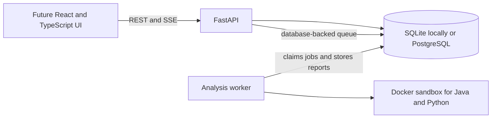

# Axioma

Axioma is an evidence-based code analysis platform for Java and Python. It is being built as a student project in small, reviewable phases. Every report is meant to say what was checked, how it was checked, and how strong that evidence is. A green result means the configured checks passed; it is not a proof of correctness.

The backend-first API contract is documented in [docs/api-contract.md](docs/api-contract.md). The frontend is intentionally waiting for the UI designs the project owner will provide.

## Architecture



The API validates requests and stores jobs. A separate worker claims jobs and executes submitted programs inside Docker. Do not expose this local setup as a public code execution service: the worker has access to the Docker daemon, and containers share the host kernel.

## Current implementation

### Built

- FastAPI job API with durable states, idempotency keys, cancellation, persisted status events, and Server-Sent Events.
- SQLite development setup and Alembic migrations; PostgreSQL is configured through `DATABASE_URL`.
- Separate worker process with queue leases, recovery for expired work, and Java/Python execution adapters.
- Mode 1 problem validation, constraint-aware generated inputs, and Java/Python sample harnesses for function and stdin/stdout problems.
- Evidence claims, reconciled test counts, categorical confidence, complexity result structure, and ordered verification-gate schema.
- Low-confidence static complexity heuristics for Python and Java; optional Python line-event/opcode-count and Java JVM wall-time growth fitting with constraint-scale context.
- Reproducible Mode 1 evaluators for complexity-class estimates and test detection; no gold data or performance claim is included yet.
- Optional Python and Java reference-guided differential checks, capped exhaustive checks for small positional integer domains, and bounded Python AST mutation testing. A supplied reference is checked against the examples first, but that does not prove it correct.
- User-provided Python and Java optimization candidates are checked against declared outputs and, when available, user-reference generated cases. Optional measurements are kept separate: Python compares source-line and opcode events; Java compares warmed JVM reflective wall time, all at low confidence.
- User-supplied Python and Java property predicates run against examples and seeded generated inputs in the sandbox; predicates are gated on example checks and labeled low confidence.
- Threat model, API contract, architecture decision records, and risk register under `docs/`.

### Not built or not verified yet

- The Docker sandbox has not been run in this development environment because Docker is unavailable here. The security settings in the runner need validation on a machine with Docker Desktop and Linux containers.
- No frontend, authentication, user accounts, hosted deployment, GitHub App, or VS Code extension exists yet.
- No Mode 2 repository ingestion/repair engine, trained defect-risk model, or benchmark evaluation report exists yet.
- Mode 1 does not yet have a generated trusted oracle, automated optimization proposals, or a curated golden evaluation set. Property checks use user-supplied predicates over generated inputs, not a shrinking property-testing framework.

See [docs/risk-register.md](docs/risk-register.md) and [docs/threat-model-v1.md](docs/threat-model-v1.md) for known limitations and security assumptions.

## Run locally on Windows

Use Python 3.13 or 3.14 and Git. Docker Desktop with Linux containers is needed to run the worker's sandbox. The API and its tests can run with SQLite without Docker.

Create and install the local environment from the repository root:

```powershell
py -3.13 -m venv services/api/.venv
services/api/.venv/Scripts/python -m pip install -r services/api/requirements.lock
services/api/.venv/Scripts/python -m pip install -e services/api --no-deps
services/api/.venv/Scripts/python -m pip install -e services/worker --no-deps
```

Run the database migrations and start the API from `services/api`:

```powershell
Set-Location services/api
.\.venv\Scripts\alembic upgrade head
.\.venv\Scripts\uvicorn axioma_api.main:app --reload
```

Open <http://127.0.0.1:8000/docs> for interactive API documentation. The default local database is SQLite. To use PostgreSQL, start it with `docker compose up -d postgres` from the repository root and set `DATABASE_URL` using the example in `.env.example` before starting the API.

Start the worker in a second terminal from `services/api`:

```powershell
.\.venv\Scripts\axioma-worker
```

The worker expects local `python:3.13-slim` and `eclipse-temurin:21-jdk` images to be available. Pull them once during setup:

```powershell
docker pull python:3.13-slim
docker pull eclipse-temurin:21-jdk
```

The worker does not pull images while processing jobs. For the sandbox design and limits, see [docs/adr/0003-database-queue-and-docker-worker.md](docs/adr/0003-database-queue-and-docker-worker.md) and the threat model.

## Run checks

From `services/api`:

```powershell
.\.venv\Scripts\ruff check src tests migrations ..\worker\src ..\worker\tests
.\.venv\Scripts\python -m pytest tests ..\worker\tests
```

The separate gold-set evaluator is documented in [evaluation/mode1/README.md](evaluation/mode1/README.md). It will not produce meaningful project-level results until at least 50 solutions have been independently labeled.

The current API and worker test suites pass locally without invoking Docker. This verifies application behavior and generated sandbox commands; it does not verify the Docker runtime or its isolation on this host.

## Contract guarantees

- Claims use evidence types `executed`, `static`, `statistical`, `model`, or `unverified`, with confidence `high`, `medium`, or `low`.
- Complexity results include a method, estimate, confidence, and `methods_disagree` field.
- Test totals are derived from stored test records, so total equals passed plus failed plus skipped.
- Verification gates have a stable order and a `passed`, `failed`, or `not_run` state. The schema is ready for Mode 2; repository repair is not implemented yet.
- Job status changes are persisted and streamable; clients may reconnect using the last event ID.

## Learning and project phases

The owner is learning the implementation phase by phase. Completed work should be explained in terms of the files changed, the design choice, how to run or verify it, and the remaining limitations. Mode 1 and its evaluation come before Mode 2 or ML, as specified in the original scope. See the original brief and the risk register before expanding the project scope.
