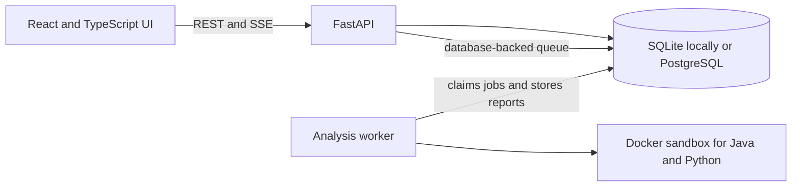

# Axioma

Axioma is an evidence-based code analysis platform for Java and Python. It is being built as a student project in small, reviewable phases. Every report is meant to say what was checked, how it was checked, and how strong that evidence is. A green result means the configured checks passed; it is not a proof of correctness.

The API contract is documented in [docs/api-contract.md](docs/api-contract.md). The Mode 1 React workspace lives in [frontend/](frontend/); the separate `frontend-prototype/` folder is a visual reference and is not part of the running app.

## Architecture



The API validates requests and stores jobs. A separate worker claims jobs and executes submitted programs inside Docker. Do not expose this local setup as a public code execution service: the worker has access to the Docker daemon, and containers share the host kernel.

## Current implementation

### Built

- FastAPI job API with durable states, idempotency keys, cancellation, persisted status events, and Server-Sent Events.
- SQLite development setup and Alembic migrations; PostgreSQL is configured through `DATABASE_URL`.
- Separate worker process with queue leases, recovery for expired work, and Java/Python execution adapters.
- Mode 1 problem validation, constraint-aware generated inputs, repeatable adversarial complexity benchmarks, and Java/Python sample harnesses for function and stdin/stdout problems.
- Evidence claims, reconciled test counts, categorical confidence, complexity result structure, and ordered verification-gate schema.
- Low-confidence static complexity heuristics for Python and Java with visible detected code signals; optional Python line-event/opcode-count and Java JVM wall-time growth fitting with constraint-scale context. Python recognizes guarded adjacency-list BFS/DFS and tree walks; Java recognizes guarded adjacency-list BFS/DFS, recursive tree-child walks, and binary search. These are syntax patterns, not exhaustive algorithm recognition or proof of complexity.
- Reproducible Mode 1 evaluators for complexity-class estimates, test detection, optimization preservation/paired measurements, and observed job latency. Complexity and detection reports include uncertainty intervals; confidence calibration requires solution-ID-separated partitions. No gold data or measured latency/performance claim is included yet.
- Optional Python and Java reference-guided differential checks, with an optional second independent implementation to catch disagreement, capped exhaustive checks for small positional integer domains, and bounded Python AST or Java operator mutation testing. References are checked against the examples first, but agreement does not prove correctness.
- User-provided Python and Java optimization candidates are checked against declared outputs and, when available, user-reference generated cases. Optional measurements are kept separate: Python compares source-line and opcode events and reports a Python-traced peak-allocation estimate; Java compares warmed JVM reflective wall time and heap-pool peak-increase estimates. All measurements are low confidence and have documented limitations.
- User-supplied Python and Java property predicates run against examples and seeded generated inputs in the sandbox; predicates are gated on example checks and labeled low confidence.
- Threat model, API contract, architecture decision records, and risk register under `docs/`.
- GitHub Actions CI runs the API, worker, and evaluator tests, Python lint, frontend lint/build, and Docker sandbox checks on pushes and pull requests. [Hosted CI run #27 for commit `3d8f7f6`](https://github.com/abhinavvgoell/axioma/actions/runs/39783780658) passed all jobs. Local Docker Desktop verification passed for the Mode 1 checks on 2026-10-20.
- Mode 1 React workspace for Python and Java function or stdin/stdout submissions, live job status, evidence claims, test counts, complexity estimates, and verification gates.
- Browser-local recent run history stores job IDs, self-assigned topic tags, and report summaries (never source code); users can reopen server-side reports, export the displayed job and report as JSON, clear local history, and review descriptive topic failure counts and recent complexity estimates.
- Function jobs can provide one reference and an independent second reference; both must match samples and each other before their outputs are used for differential checks. The UI describes this as corroboration, not proof.
- Function-problem UI can submit a user-provided optimization candidate and optional benchmark inputs; it shows equivalence counts, before/after estimates, measurements, and their limits. It does not generate or silently apply code changes.
- Rule-based proposals recognize a narrow integer-array sum pattern in Python/Java and a nested Two Sum search in Python. The analyzer can present the Two Sum hash-map candidate and run it against the matched test pack plus increasing-size benchmarks; suggestions stay static and low-confidence until checked, and no LLM provider is called.

### Not built or not verified yet

- The Docker sandbox runs locally on Windows Docker Desktop's Linux backend. All six Docker integration checks passed on 2026-10-20; the [hosted Linux CI run #27](https://github.com/abhinavvgoell/axioma/actions/runs/39783780658) passed for commit `3d8f7f6`.
- Authentication, user accounts, hosted deployment, GitHub App, and VS Code extension do not exist yet.
- No Mode 2 repository ingestion/repair engine, trained defect-risk model, or benchmark evaluation report exists yet.
- Mode 1 does not have a general trusted oracle, broad optimization-proposal coverage, or a curated golden evaluation set. Proposal rules cover only a few exact patterns, not arbitrary code. Property checks use user-supplied predicates over generated inputs, not a shrinking property-testing framework.
- There are no independently selected optimization-evaluation runs or measured component-latency report yet; the optimization evaluator is ready to score saved paired evidence without inventing results.
- The Mode 1 dashboard is still incomplete: local topic summaries are descriptive and are not a validated skill model; there is no cross-device history, account-level data deletion, or cross-user complexity trend analysis. Recent history is local to one browser and does not add accounts or server-side user ownership.

See [docs/risk-register.md](docs/risk-register.md) and [docs/threat-model-v1.md](docs/threat-model-v1.md) for known limitations and security assumptions.

Track Mode 1 requirements and Gate 1 evidence in [docs/mode1-readiness.md](docs/mode1-readiness.md). Mode 2 remains deferred until that gate is met.

## Run locally on Windows

Use Python 3.13 or 3.14 and Git. Docker Desktop with Linux containers is needed to run the worker's sandbox. The API and its tests can run with SQLite without Docker.

Create and install the local environment from the repository root:

```powershell
py -3.13 -m venv services/api/.venv
services/api/.venv/Scripts/python -m pip install -r services/api/requirements.lock
services/api/.venv/Scripts/python -m pip install -e services/api --no-deps
services/api/.venv/Scripts/python -m pip install -e services/worker --no-deps
```

Run the database migrations and start the API from `services/api`:

```powershell
Set-Location services/api
.\.venv\Scripts\alembic upgrade head
.\.venv\Scripts\uvicorn axioma_api.main:app --reload
```

Open <http://127.0.0.1:8000/docs> for interactive API documentation. The default local database is SQLite. To use PostgreSQL, start it with `docker compose up -d postgres` from the repository root and set `DATABASE_URL` using the example in `.env.example` before starting the API.

Start the worker in a second terminal from `services/api`:

```powershell
.\.venv\Scripts\axioma-worker
```

The worker expects local `python:3.13-slim` and `eclipse-temurin:21-jdk` images to be available. Pull them once during setup:

```powershell
docker pull python:3.13-slim
docker pull eclipse-temurin:21-jdk
```

The worker does not pull images while processing jobs. For the sandbox design and limits, see [docs/adr/0003-database-queue-and-docker-worker.md](docs/adr/0003-database-queue-and-docker-worker.md) and the threat model.

Run the Mode 1 frontend in another terminal from `frontend`:

```powershell
Set-Location frontend
npm ci
npm run dev
```

Open <http://127.0.0.1:5173/>. The Vite development server proxies `/api` to the local API on port 8000. The frontend can submit and display jobs with the API alone, but running code and receiving a completed report also requires the worker and Docker sandbox described above. See [frontend/README.md](frontend/README.md) for the frontend commands and scope.

## Run checks

From `services/api`:

```powershell
.\.venv\Scripts\ruff check src tests migrations ..\worker\src ..\worker\tests
.\.venv\Scripts\python -m pytest tests ..\worker\tests
```

The separate gold-set evaluator is documented in [evaluation/mode1/README.md](evaluation/mode1/README.md). It will not produce meaningful project-level results until at least 50 solutions have been independently labeled.

Local verification on 2026-10-20: API tests (41 passed), worker tests including Docker integration (66 passed), evaluator tests (24 passed), Python lint, frontend lint, and frontend production build. End-to-end sample jobs passed in Java and Python for both function and stdin/stdout interfaces. These checks do not establish that imported third-party test packs are correct or equivalent to LeetCode hidden judge tests.

## Contract guarantees

- Claims use evidence types `executed`, `static`, `statistical`, `model`, or `unverified`, with confidence `high`, `medium`, or `low`.
- Complexity results include a method, estimate, confidence, and `methods_disagree` field.
- Test totals are derived from stored test records, so total equals passed plus failed plus skipped.
- Verification gates have a stable order and a `passed`, `failed`, or `not_run` state. The schema is ready for Mode 2; repository repair is not implemented yet.
- Job status changes are persisted and streamable; clients may reconnect using the last event ID.

## Learning and project phases

The owner is learning the implementation phase by phase. Completed work should be explained in terms of the files changed, the design choice, how to run or verify it, and the remaining limitations. Mode 1 and its evaluation come before Mode 2 or ML, as specified in the original scope. See the original brief and the risk register before expanding the project scope.
